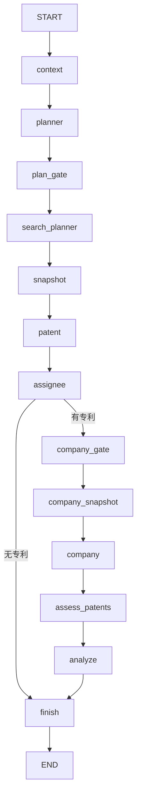

# 研究工作流：节点与返回数据流

本文对应当前 Python 研究服务实现。模型负责推荐方向、补充检索条件和分析结果；Python 负责组装计划、固定检索年份、校验方向关联和调度采集。

## 1. 从请求到工作流

```text
前端提交研究需求
  → NestJS 创建研究轮次
  → IntelligenceClient.start()
  → Python POST /runs
  → Store.create() 保存 queued 任务
  → Runtime.sweep() 发现待执行任务
  → Runtime.execute() 领取任务
  → graph.astream(value, config)
```

新任务的初始输入在 `Runtime.execute()` 中构造：

```python
value = {
    "question": row["question"],
    "conversation": row["artifacts"].get("conversation", {}),
}
```

已有检查点的任务使用保存的状态恢复，确认等操作通过 `Command(resume=...)` 传入。`config` 携带 `thread_id` 和执行租约 `lease`，用于标识工作流和校验执行者，不属于业务 `State` 字段。

## 2. 状态更新规则

`StateGraph(State)` 接收的是状态结构定义。节点收到当前共享状态，返回需要更新的字段：

```python
async def assignee(state, config):
    return {
        "assignees": assignee_workset(state["snapshot"], state["patents"])
    }
```

LangGraph 更新 `assignees`，保留 `question`、`patents` 等其他字段。当前没有配置字段 reducer，同名字段默认替换，不会自动追加列表或深度合并字典。节点无需更新状态时可以返回 `{}`。

`State` 是 `TypedDict`，不负责运行时强校验；`Plan`、`DirectionProposal`、`SearchConditions` 等 Pydantic 模型负责对应数据的校验。`model_dump()` 将模型转为普通字典，嵌套模型也会转换。

## 3. 节点执行顺序



- `plan_gate`：没有 `confirmed_plan` 时中断，等待用户确认；已有确认计划则继续。
- `company_gate`：中断并提供专利、申请人数量，等待开始企业发现。
- `assignee` 后的分支检查的是 `patents` 是否为空，不是 `assignees` 是否为空。
- 当前专利模型评估也位于企业确认之后，停在 `company_gate` 时尚未执行 `assess_patents`。

## 4. 每个节点读取和返回什么

| 节点 | 主要读取 | 返回的状态更新 | 是否调用 LLM |
|---|---|---|---|
| `context` | 服务端配置、当前年份 | `context` | 否 |
| `planner` | `question`、`conversation`；代码读取 `context` 组装年份 | 首次返回 `plan`、`reply`、`reply_intent`；其他分支见下文 | 依分支而定 |
| `plan_gate` | `plan`、`confirmed_plan`、用户确认输入、`context` | `confirmed_plan` | 否 |
| `search_planner` | 已确认方向、`question`、`conversation`；代码读取 `context` | `confirmed_plan` | 是，返回 `SearchConditions` |
| `snapshot` | `confirmed_plan` | `snapshot`、`acquisition` | 否，执行专利采集 |
| `patent` | `snapshot`、`confirmed_plan` | `patents` | 否 |
| `assignee` | `snapshot`、`patents` | `assignees` | 否 |
| `company_gate` | `patents`、`assignees` | 恢复后返回 `{}` | 否 |
| `company_snapshot` | `assignees`、`confirmed_plan` | `snapshot`、`acquisition` | 否，执行企业采集 |
| `company` | `snapshot`、`assignees`、`patents` | `company_leads` | 否 |
| `assess_patents` | `question`、`confirmed_plan`、`patents`、已保存评估进度 | `patent_assessments` | 是，每批最多 20 件 |
| `analyze` | `question`、`company_leads`、`patent_assessments`、已保存评估进度 | `company_assessments` | 是，每批最多 10 家 |
| `finish` | 专利、企业线索、两类评估、`snapshot` | `result` | 否 |

`collect_snapshot()` 是两个采集节点共用的辅助函数，不是独立注册的图节点。企业阶段返回的 `snapshot` 替换原快照，但已经整理出的 `patents` 和 `assignees` 保留。

## 5. context 与 conversation

### context：服务端研究配置

`Acquisition.context()` 当前返回：

```python
{
    "source_mode": "browser",
    "domains": [],
    "period_from_year": 1949,
    "period_to_year": datetime.now(UTC).year,
}
```

这是代码构造的配置，没有联网查询。工作流使用它填充和校验计划年份，不再把顶层 `context` 字段放入模型请求。

年份表示专利检索的时间条件，不表示技术方向诞生于该时期，也不证明该时期存在相关专利。是否有结果，需在采集阶段验证。

### conversation：对话与操作背景

由 NestJS 传入，包含历史消息、候选和已选计划，以及 `workspace`、`startSearch`、`keywordDirection` 等操作标记。它既用于 Python 选择分支，也作为模型理解历史需求的背景。历史计划中仍可能携带年份字段，但模型不负责生成执行计划的年份。

## 6. planner 的返回分支

按代码判断顺序：

| 条件 | 行为 | 返回字段 |
|---|---|---|
| `keywordDirection` | 为指定方向生成关键词并去重 | `generated_keywords`、`candidate_plan`、`reply`、`reply_intent` |
| `startSearch` | 读取已选计划，固定年份并校验 | `plan`、`confirmed_plan`、`candidate_plan`、`reply` |
| `workspace` | 继续对话并处理候选或修改建议 | `candidate_plan`、`proposal_plan`、`reply`、`reply_intent`、`plan` |
| 默认 | 首次推荐方向，再由 Python 组装计划 | `plan`、`reply`、`reply_intent` |

继续对话的意图：

- `discuss`：保留候选，回答问题。
- `refresh_candidates`：替换整批候选。
- `update_candidate`：修改已有候选。
- `propose_selected`：输出已选计划的修改建议，等待用户应用。

首次生成时，模型返回 `DirectionProposal`，例如：

```json
{
  "reply": "建议研究电池液冷技术。",
  "directions": [
    {
      "domain_id": "battery-cooling",
      "name": "电池液冷技术",
      "explanation": "研究高倍率充电场景下的散热方案",
      "keywords": ["电池液冷", "热管理"]
    }
  ]
}
```

Python 用这些方向构造 `Plan`，补入固定年份、默认页数和空的检索条件。节点返回的是 `{plan, reply, reply_intent}`；模型返回值不等于节点返回值。

## 7. 从确认计划到执行计划

`plan_gate` 校验计划和非空关键词，使用服务端年份，并清空 `excluded_keywords`、`cpc_prefixes`、`risks`，等待独立生成检索条件。

`search_planner` 的模型只返回 `SearchConditions`：

```json
{
  "directions": [
    {
      "domain_id": "battery-cooling",
      "excluded_keywords": ["建筑空调"],
      "cpc_prefixes": []
    }
  ],
  "risks": []
}
```

此结构不包含年份、页数、方向名称、描述和关键词。每个方向最多 12 个排除词、12 个分类号前缀；词条非空且最多 200 字符。整批条件包含 1～3 个方向。

Python 检查返回 ID 无重复，且与确认方向集合完全相同，再按 ID 合并；模型返回顺序可以不同，执行计划保持原方向顺序。

最终 `confirmed_plan` 示例（以当前年份 2026 为例）：

```json
{
  "pages_per_keyword": 5,
  "directions": [
    {
      "domain_id": "battery-cooling",
      "name": "电池液冷技术",
      "explanation": "研究高倍率充电场景下的散热方案",
      "keywords": ["电池液冷", "热管理"],
      "excluded_keywords": ["建筑空调"],
      "cpc_prefixes": []
    }
  ],
  "from_year": 1949,
  "to_year": 2026,
  "risks": []
}
```

- 名称、描述、方向 ID 和关键词来自已确认计划；关键词按原顺序去重。
- 排除词、分类号、风险说明来自模型。
- 年份来自服务端 `context`。
- `pages_per_keyword` 保留确认计划的值，允许 3、5、10，默认 5。
- 节点返回 `{"confirmed_plan": ...}`，不会自动同步修改 `state["plan"]`。

## 8. 从采集数据到报告

```text
confirmed_plan
  → snapshot：专利采集快照
  → patents：本次研究的专利集合
  → assignees：申请人／受让人查询线索
  → 企业采集后的 snapshot
  → company_leads：企业信息及关联专利线索

patents → patent_assessments
company_leads + patent_assessments → company_assessments
两类评估 + 企业线索 + 快照信息 → result
```

`patent_assessments` 每项包含 `patent_id`、`priority`、`reason`。`company_assessments` 每项包含 `company_id`、`priority`、`summary`、`patent_ids`。

评估节点校验模型没有增删或重复对象 ID；企业评估还校验引用的专利属于提供的线索。分批结果会持久化，恢复时跳过已完成项。

`finish` 检查评估是否覆盖全部专利和企业，再生成：

```python
{
    "result": {
        "companies": [...],  # 企业线索合并评估，排序
        "patents": [...],    # 专利评估结果，排序
        "patent_count": ...,
        "release_id": ...,
        "missing": [...],   # 尚缺权属、法律状态、市场等核验信息
        "empty_reason": None,  # 无专利时提供原因
        "workflow_version": "browser-v3",
        "prompt_version": "browser-v3",
    }
}
```

企业查询命中只代表调研线索，不证明企业拥有对应专利。没有专利时直接走 `finish`，输出空结果和原因。

## 9. 图状态与进度事件

系统有两条数据路径：

| 路径 | 用途 |
|---|---|
| 节点 `return` → LangGraph 状态与检查点 | 供后续节点读取，并支持工作流恢复 |
| `store.publish()` → 任务 artifacts 与事件 | 保存并展示流式回答、采集进度、分批评估结果 |

节点包装函数先发布 `node_started`，执行业务函数，校验租约后返回结果。Runtime 消费 `graph.astream()` 的状态，将业务字段合并进 artifacts 并发布 `node_completed` 事件。

LLM 生成回答时发布 `answer_progress`；采集和分析也可在节点完成前发布进度。因此前端能先看到过程更新，再看到完整节点结果。NestJS 同步 Python 状态和事件，前端通过 API 与 SSE 获取展示数据。

## 10. 代码入口

- [workflow.py](../services/research/src/tech_scout_intelligence/workflow.py)：状态定义、节点实现、图构建。
- [models.py](../services/research/src/tech_scout_intelligence/models.py)：方向、检索条件、计划、评估结果模型。
- [runtime.py](../services/research/src/tech_scout_intelligence/runtime.py)：初始输入、后台调度、恢复、状态发布。
- [acquisition.py](../services/research/src/tech_scout_intelligence/acquisition.py)：服务端 context 和采集边界。
- [llm.py](../services/research/src/tech_scout_intelligence/llm.py)：模型请求、结构化校验和流式回答。
- [prompts.py](../services/research/src/tech_scout_intelligence/prompts.py)：方向推荐与对话提示词。
- [store.py](../services/research/src/tech_scout_intelligence/store.py)：任务存储、事件发布、计划业务校验。
