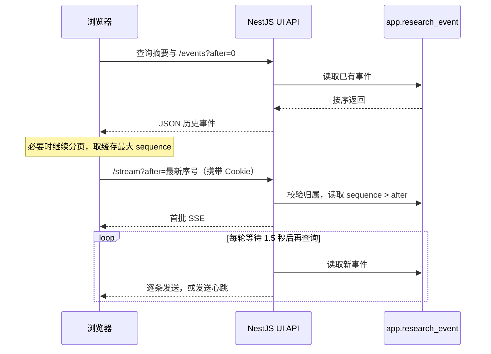

# 03 · 历史加载、SSE 订阅与页面更新

[返回目录](README.md) · [上一篇](02-python-to-nestjs.md) · [下一篇：断线与结束](04-reconnect-and-end.md)

## 打开页面后的顺序

入口是 [useResearchRun](../../apps/web/src/features/research/use-research-run.ts)。Hook 建立摘要查询和历史事件查询，只有摘要表明任务为 `queued/running`，且历史查询成功，才创建 EventSource。



## /events：加载一批后结束

[researchApi.events(id)](../../apps/web/src/lib/research-api.ts) 每次调用从 `after=0` 开始，循环分页：

```text
/events?after=0    → 返回 1～100
/events?after=100  → 返回 101～150
不足 100 条，停止分页
```

满页时，用最后一条的实际序号更新 after，不是固定加 100。若下一游标不大于上一游标则抛错，避免重复请求造成死循环。

这里的循环是一系列短请求，不是 SSE。如果恰好返回 100 条，即使已经读完，也会再请求一次，直到拿到不足 100 条的结果。

## /stream：保持连接

历史加载成功后，前端从缓存中取最大 `sequence` 初始化游标：

```typescript
cursor.current = Math.max(cursor.current, ...existing.map((e) => e.sequence))
const stream = new EventSource(
  `/api/v1/research/ui/runs/${encodeURIComponent(id)}/stream?after=${cursor.current}`,
  { withCredentials: true }
)
```

已有事件为空时，初始游标为 0。任务 ID 改变时游标会重置。

建立连接的决定来自摘要状态和历史查询结果，不是“只要没 close 就会建立”。Hook 中的判断可简化为：

```typescript
const active = status === 'queued' || status === 'running'
const ready = events.isSuccess
useEffect(() => {
  if (!active || !ready) return
  const stream = new EventSource(url, { withCredentials: true })
  // 绑定消息处理……
  return () => stream.close()
}, [id, active, ready, client])
```

这是流程示意，实际 cleanup 还清理定时器。数据返回会使组件重新渲染，依赖变化时 effect 才重新执行；普通重渲染不会每次都新建连接。active 变为 false 时，React 先清理旧 effect、关闭旧连接，再执行新 effect 并直接 return。组件卸载也会清理。

“首次是否建立”由 `active && ready` 决定；“网络断开后是否自动重连”是已存在的 EventSource 的行为，详见 [断线、刷新与结束](04-reconnect-and-end.md)。

如果历史查询结束时读到 5，而连接建立前数据库已保存了 6、7，`after=5` 仍会查出 6、7，因此这两步之间新增的已保存事件可以补回来。

## 后端 Controller → Service → Repository

```text
ResearchViewController.stream()
  → AuthGuard 验证登录 Cookie，校验 UUID 和游标
  → 选择 Last-Event-ID ?? query.after
  → ResearchViewService.events()
    → 校验任务归属于当前用户
    → repository.runEvents() 查询应用事件表
    → 整理 UI 展示字段
  → 设置 text/event-stream 响应头
  → 逐条发送，并持续查询
```

首次查询发生在发送 SSE 响应头之前，权限或任务不存在等错误仍可作为普通 HTTP 错误返回。后续每轮读取也经过归属检查。

相关源码：[Controller](../../apps/api/src/research/research-view.controller.ts)、[Service](../../apps/api/src/research/research-view.service.ts)、[Repository](../../apps/api/src/research/research.repository.ts)。

Service 会将非执行状态下仍标为 streaming 的回答，整理为 interrupted 展示状态；这是读取结果的处理，不是这里重新写入事件。

每条发送格式为：

```text
id: 6
data: {"sequence":6,"kind":"answer_progress",...}

```

发送后更新服务端本次连接的 `after`。一批最多 100 条，会连续发送；没有新数据时发送 `: keepalive` 注释，它不会触发浏览器 `onmessage`。

## 浏览器收到消息后做什么

`onmessage` 依次解析 JSON、校验 schema，并忽略 `sequence <= cursor.current` 的事件。通过校验后更新游标和事件缓存。

- 非执行状态事件或 `node_completed` 会触发相应工作区查询失效。
- 600ms 定时器将密集事件引发的摘要刷新请求合并。
- 摘要状态变化后，相关项目查询也会失效刷新。

事件并不是一到达就直接改掉摘要中的 status；通常要通过摘要重新获取，才使 `active` 变化。

## 为什么还保留轮询

运行期间，摘要和事件查询都配置了 5 秒刷新间隔。历史查询仍通过 `researchApi.events(id)` 从 0 分页读取，缓存合并逻辑按 `sequence` 去重并排序。

因此历史与 SSE 数据可以汇合：重复序号不会在合并后的历史列表中变成两条。SSE 异常时，轮询也提供补齐和状态发现渠道。

摘要变为非执行状态后，会关闭 SSE，并使事件查询失效以补拉最终事件。这可处理“摘要先发现完成，而最后的 SSE 尚未到达”的情况。

## 自检

1. 两个接口都能取历史，为什么要分开？普通请求便于加载和补齐，长连接用于持续接收。
2. UI SSE 是否直接调用 Python？不调用，只读取后台已同步的应用事件表。
3. 每隔 1.5 秒只收到一条吗？不一定，一轮可以是多条业务事件，也可以只有心跳。
