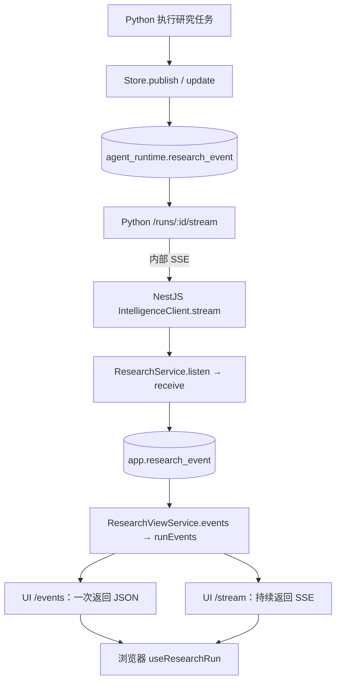

# 研究任务 SSE 全链路学习指南

这组文档对照当前项目源码，解释研究事件如何从 Python 到达浏览器，以及页面刷新、网络断开、任务结束时发生什么。示例序号仅用于讲解，不代表某个实际任务的数据。

## 阅读顺序

1. [事件、序号与数据库](01-events-and-sequence.md)：理解事件、`sequence`、`after`，再看 SQL。
2. [Python → NestJS](02-python-to-nestjs.md)：理解事件生成、后台订阅和落库。
3. [NestJS → 浏览器](03-nestjs-to-browser.md)：理解历史加载、实时订阅和页面更新。
4. [断线、刷新与结束](04-reconnect-and-end.md)：把两段连接的生命周期串起来。

每篇都包含流程、源码入口和自检问题。建议先读本页总览，再按顺序打开对应源码。业务上的规划、采集和报告流程另见 [研究节点与返回数据流](../research-node-data-flow.md)。

## 先记住这张图



图中画的是两段研究事件 SSE；如果把上游大模型的流式响应也计入，完整链路有**三段流，以及两套不同 schema 下的事件表**。它们可以位于同一 PostgreSQL 部署中，不能简单理解为两台数据库。

```text
大模型流式输出
  → Python 处理模型内容，生成研究事件
  → agent_runtime.research_event
  → Python SSE 查询并发送
  → NestJS 接收并保存到 app.research_event
  → NestJS UI SSE 查询并发送
  → 浏览器展示
```

Python 是边接收模型输出边发布进度，不必等回答全部生成完。模型原始 chunk、数据库中的业务事件、SSE 传输帧是三个不同概念，数据库保存的是业务事件数据，不是原始 `id: ...\ndata: ...` 文本。部分内部模型调用使用普通响应，不是所有模型请求都走流式输出。

- Python → NestJS：后台订阅研究服务的事件，保存到应用事件表。
- NestJS → 浏览器：从应用事件表查询数据，发送 UI 所需的进度事件。

前端请求 UI `/stream` 后，Controller 的读取链路到数据库为止。它不会直接转发 Python 的流，也不会因此启动 `ResearchService.listen()`。

## 三个入口分别负责什么

| 接口 | 调用方 | 返回内容与用途 |
| --- | --- | --- |
| Python `/runs/{run_id}/stream` | NestJS 后台 | 原始研究事件，包含状态快照 |
| NestJS `/api/v1/research/ui/runs/{runId}/events` | 浏览器 | 一批 UI 事件，用于历史加载和补齐 |
| NestJS `/api/v1/research/ui/runs/{runId}/stream` | 浏览器 | 持续发送 UI 事件，用于进度更新 |

两个 UI 接口都读取已保存的事件；“历史事件”没有独立的类型或表。

## 为什么要先存库，再通过 SSE 发送

这套设计将研究执行、应用同步和页面展示分开，让长时间任务不依赖浏览器持续在线。

1. **Python 保存执行历史**：即使 NestJS 断线，研究仍可继续保存事件。重连带上游标后可以补发，不必让模型重新生成内容。事件还包含搜索、采集和执行状态，不只包含模型回答。
2. **NestJS 保存应用侧副本**：应用层负责用户登录、任务归属和 UI 数据提取；Python 暂时不可用时，已经同步的历史仍可读取。多个页面连接读取同一份应用记录，不必各自连接 Python。
3. **前端统一读取历史与实时进度**：刷新时读取已有事件，保持连接时持续读取新增事件，两者以相同序号衔接。

例如 Python 已保存到 10，NestJS 只收到 6，后台恢复后可以补拉 7～10；浏览器只收到 3，则可以再从应用事件表补读 4～10。各层的已读位置可能暂时不同。

这不是 SSE 协议规定的架构，而是当前项目对长时间研究、暂停恢复和回放需求的取舍：

| 收益 | 对应成本 |
| --- | --- |
| 执行与展示独立，支持回放 | 两套事件存储，状态快照增加存储量 |
| 断线后从已保存位置继续 | 需要同步、补拉、去重和重连逻辑 |
| 页面读取不直接依赖 Python 在线 | 应用事件副本可能暂时落后 |
| 用数据库统一读取历史和新增事件 | 两段轮询增加延迟与查询压力 |

简单聊天可以直接转发模型流并按需保存回答。当前需求支持采用持久化事件，但不意味着必须保存两份；此处解释现有实现，不是要求所有 SSE 系统照搬。

## 代码导航

| 代码 | 阅读重点 |
| --- | --- |
| [Python llm.py](../../services/research/src/tech_scout_intelligence/llm.py) | `DeepSeek.generate`：模型流、内容累积与进度发布 |
| [Python store.py](../../services/research/src/tech_scout_intelligence/store.py) | `publish`、`update`、`events`：生成序号、保存和查询 |
| [Python app.py](../../services/research/src/tech_scout_intelligence/app.py) | `stream_events`：输出 SSE |
| [intelligence.client.ts](../../apps/api/src/research/intelligence.client.ts) | `stream`：fetch 与 SSE 解析 |
| [research.service.ts](../../apps/api/src/research/research.service.ts) | `sync`、`listen`、`receive`、`tick` |
| [research-view.controller.ts](../../apps/api/src/research/research-view.controller.ts) | UI `events`、`stream` 接口 |
| [research-view.service.ts](../../apps/api/src/research/research-view.service.ts) | 归属校验与展示数据整理 |
| [research.repository.ts](../../apps/api/src/research/research.repository.ts) | `runEvents`：SQL 查询与 JSON 字段投影 |
| [research-api.ts](../../apps/web/src/lib/research-api.ts) | 历史事件分页加载 |
| [use-research-run.ts](../../apps/web/src/features/research/use-research-run.ts) | EventSource、缓存、轮询、关闭 |

## 时间间隔不要混淆

| 位置 | 当前行为 |
| --- | --- |
| Python SSE | 每轮发送事件后等待 1 秒，再查事件表，每批最多 20 条 |
| UI SSE | 首批立即发送；每轮之后等待 1.5 秒再查询，每批最多 100 条 |
| NestJS 后台检查 | 每 2 秒尝试触发 `tick()`，受防重入和批量处理影响 |
| 浏览器轮询 | 执行期间摘要与历史事件各设置 5 秒刷新间隔 |
| 浏览器收到 SSE | 用 600ms 定时器合并触发摘要失效刷新 |

这些是循环等待或刷新配置，不是严格的消息发送频率，也不是端到端延迟保证。例如 UI 一轮可能连续发 10 条事件，也可能只发心跳。

下一篇：[事件、序号与数据库](01-events-and-sequence.md)。
